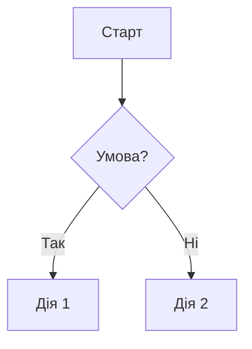
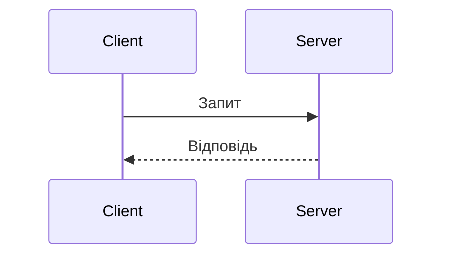

Заголовки:
# H1
## H2
### H3
#### H4
##### H5
###### H6

# Стилі тексту:
**жирний**  або  __жирний__
*курсив*  або  _курсив_
***жирний курсив***
~~закреслений~~
`інлайн-код`
<sub>нижній індекс</sub>  <sup>верхній індекс</sup>
<ins>підкреслений</ins>
<kbd>Ctrl</kbd> + <kbd>C</kbd>
<mark>виділений</mark>  (підтримується не скрізь)

# Списки:
- пункт
- пункт
  - вкладений (2 пробіли відступу)

1. перший
2. другий
   1. вкладений

- [x] виконано
- [ ] не виконано

# Посилання:
[текст](https://example.com)
[з підказкою](https://example.com "Підказка")
[відносне посилання](./docs/INSTALL.md)
[якір на розділ](#встановлення)
<https://example.com>

[посилання-референс][id]
[id]: https://example.com

# Зображення:


<!-- зміна розміру та вирівнювання -->


<p align="center">
  
</p>

# Картинки для різних тем:
<picture>
  <source media="(prefers-color-scheme: dark)" srcset="logo-dark.png">
  <source media="(prefers-color-scheme: light)" srcset="logo-light.png">
  
</picture>

# Блоки коду:
```python
def hello():
    print("Привіт!")
```

```bash
npm install my-package
```

```json
{ "name": "demo" }
```

```diff
- видалений рядок
+ доданий рядок
```

# Таблиці:
| Параметр | Тип    | За замовчуванням | Опис            |
|:---------|:------:|-----------------:|-----------------|
| `name`   | string | `"app"`          | Назва проєкту   |
| `port`   | number | `3000`           | Порт сервера    |

# Цитати:
> Звичайна цитата
>
> > Вкладена цитата

# Нативність:
> [!NOTE]
> Корисна інформація, яку варто знати.

> [!TIP]
> Порада для кращого результату.

> [!IMPORTANT]
> Ключова інформація для успіху.

> [!WARNING]
> Критично важливий момент, потрібна увага.

> [!CAUTION]
> Негативні наслідки та ризики.

# Розривні секції:
<details>
<summary>Натисніть, щоб розгорнути</summary>

Прихований вміст (порожній рядок після `summary` обов'язковий,
щоб працював Markdown всередині).

```js
console.log("hidden");
```

</details>

# Розділювачі та перенесення рядків:
---
***
___

# Діаграми:


